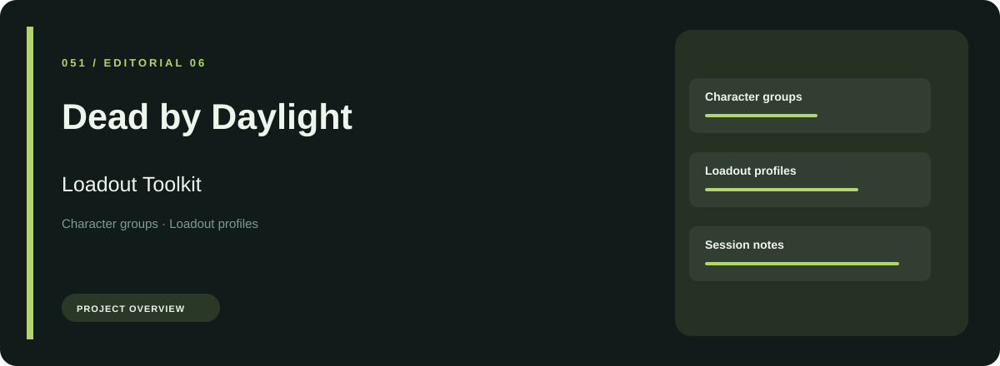
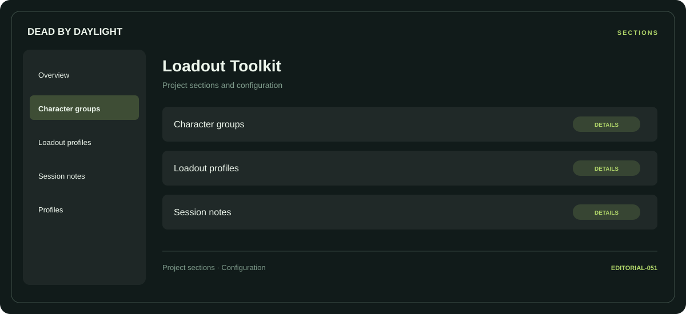

# 🧭 Dead by Daylight Loadout Toolkit

**Character groups · Loadout profiles · Session notes**

## ⚡ Features

Dead by Daylight Loadout Toolkit groups character groups, loadout profiles, and session notes in a single workspace. Each section keeps its controls and related settings together.

### ⚙️ Character groups

Character-related parameters and the settings associated with the selected category.

### 🧩 Loadout profiles

Related settings collected into named groups for a clearer configuration workflow.

### ⌨️ Session notes

Session and activity information grouped by the task or context it belongs to.

## 🖥️ Project navigation

## 📥 Download

The button and cover open the project's download page. Use the information supplied with the downloaded package for installation and release-specific requirements.

## 📚 Project documentation

- [Feature reference](docs/FEATURES.md)
- [Download information](docs/DOWNLOAD.md)
- [Project page](index.html)

---

Dead by Daylight Loadout Toolkit · Program documentation and download information.
